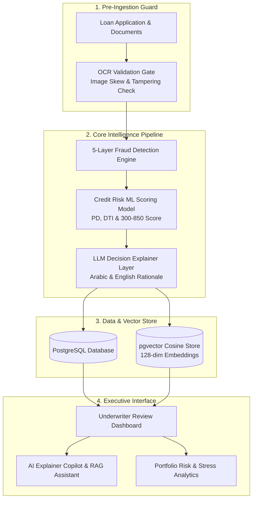

# CrediX — AI-Powered Credit Assessment & Fraud Detection Platform

<div align="center">

[](https://credix-green.vercel.app)
[](https://fastapi.tiangolo.com)
[](https://nextjs.org)
[](https://github.com/pgvector/pgvector)
[](https://www.cbe.org.eg)

**An intelligent end-to-end decision-support and risk-underwriting ecosystem engineered for the financial and retail banking sector.**

[Explore Platform Live](https://credix-green.vercel.app) • [Architecture](#-system-architecture) • [Core Capabilities](#-core-capabilities) • [Microservices Ecosystem](#-microservices-ecosystem)

</div>

---

## 📌 Executive Summary

**CrediX** is an enterprise-grade AI banking platform built to streamline and automate credit decisioning, risk evaluation, and fraud mitigation in compliance with **Central Bank of Egypt (CBE)** regulations. 

By unifying **Machine Learning credit models**, a **5-layer fraud defense engine**, **pgvector semantic similarity search**, and **LLM decision explainability**, CrediX slashes loan approval latencies by over **70%** while shielding lenders against financial fraud and identity tampering.

---

## 🏗 System Architecture

CrediX operates on an asynchronous, multi-stage underwriting pipeline orchestrated through FastAPI and microservices:



---

## 🚀 Core Capabilities

### 1. 📊 End-to-End Credit Risk Scoring
* **Comprehensive ML Modeling:** Trained risk classifiers predicting Probability of Default (PD) and scaling output to standardized **300–850 credit scores**.
* **Engineered Ratios:** Real-time computation of Debt-to-Income (DTI), Disposable Income buffers, and employment stability indices.
* **Risk Categorization:** Dynamic assignment into Prime, Near-Prime, and Sub-Prime risk tiers with automatic underwriting recommendations (*Approve*, *Manual Review*, *Decline*).

### 2. 🛡️ 5-Layer Fraud Detection Architecture
An in-depth multi-layered defense mechanism designed to intercept fraudulent applicants:
* **Layer 1: Deterministic Rules:** National ID checksum, age limits, and internal sanctions/blacklist checks.
* **Layer 2: Cross-Matching:** Cross-verification between declared HR employment letter salaries and recurring bank statement deposits.
* **Layer 3: Document Integrity:** OCR Gate validation detecting font discrepancies, tampered metadata, and date continuity flaws.
* **Layer 4: Behavioral & Velocity Anomalies:** Rapid cash depletion velocity and multi-lender credit inquiry spikes.
* **Layer 5: Composite Risk Scoring:** Aggregated weighted fraud score (0–100) with detailed risk indicators for human auditors.

### 3. 🔍 Semantic Applicant Matching (`pgvector`)
* Integrated PostgreSQL `pgvector` with 128-dimensional embedding vectors.
* Cosine distance indexing (`ivfflat`) via `GET /applications/{id}/similar` to identify semantically similar historical loan files for risk benchmarking and syndicate fraud detection.

### 4. 🤖 Bilingual LLM Explainer & AI Copilot
* Translates mathematical risk matrices into human-readable business justifications in **Arabic and English**.
* Produces legally compliant **Adverse Action Statements** clarifying the exact grounds for rejection.
* Embedded directly inside the application evaluation view as an interactive AI Underwriting Copilot.

### 5. 📈 Portfolio Risk & Sensitivity Analytics
* **Expected Loss (EL) Modeling:** $\text{Expected Loss} = \text{PD} \times \text{LGD} \times \text{EAD}$.
* **Macroeconomic Stress-Testing:** Dynamic simulation of economic shocks (interest rate hikes, inflation surges, and industry sector defaults).

---

## 🧩 Microservices Ecosystem

The platform is designed around modular, decoupled repositories engineered for independent scalability:

| Microservice / Component | Repository | Description |
| :--- | :--- | :--- |
| **Credit Risk & Fraud Core** | [`tasneem33355/credit-risk-model`](https://github.com/tasneem33355/credit-risk-model) | Jupyter ML training pipeline, feature engineering, and the full 5-layer fraud engine (`fraud_engine.py`). |
| **Portfolio Analytics** | [`tasneem33355/portfolio-analytics-service`](https://github.com/tasneem33355/portfolio-analytics-service) | Financial microservice calculating Expected Loss, portfolio distributions, and stress testing. |
| **LLM Explainer Service** | [`tasneem33355/llm-explainer-service`](https://github.com/tasneem33355/llm-explainer-service) | Standalone LLM reasoning service providing dual-language credit explanations and adverse notices. |
| **Main Platform & Web UI** | [`tasneem33355/CrediX`](https://github.com/tasneem33355/CrediX) | FastAPI backend orchestrator, pgvector setup, and Next.js 16 production web application. |

---

## 💻 Tech Stack

* **Machine Learning & AI:** Python, Scikit-Learn, PyTorch, Pandas, NumPy, HuggingFace Transformers, LangChain, RAG.
* **Backend & Microservices:** FastAPI, Pydantic, Uvicorn, Docker, RESTful APIs.
* **Database & Vector Search:** PostgreSQL, `pgvector`, SQLAlchemy, Supabase Auth.
* **Frontend Dashboard:** Next.js 16 (App Router), TypeScript, Tailwind CSS, Lucide Icons, Recharts.
* **Cloud & CI/CD:** Vercel (Production Frontend), Railway (AI Services), GitHub Actions.

---

## ⚡ Getting Started Locally

### 1. Clone the Repository
```bash
git clone https://github.com/tasneem33355/CrediX.git
cd CrediX
```

### 2. Backend Setup
```bash
cd backend
python -m venv venv
source venv/bin/activate  # On Windows: venv\Scripts\activate
pip install -r requirements.txt
uvicorn app.main:app --reload --port 8000
```
* Interactive API Documentation: `http://localhost:8000/docs`

### 3. Frontend Setup
```bash
cd ../frontend
npm install
npm run dev
```
* Web Dashboard: `http://localhost:3000`

---

## 🌐 Live Production Verification

The platform is deployed and operational in production:
* **Web Platform:** [https://credix-green.vercel.app](https://credix-green.vercel.app)
* **Status:** Verified and integrated with live PostgreSQL databases and AI inference endpoints.

---

<div align="center">
  <sub>Developed with engineering rigor by <strong>Tasneem Mohamed</strong> & the CrediX Engineering Team</sub>
</div>
